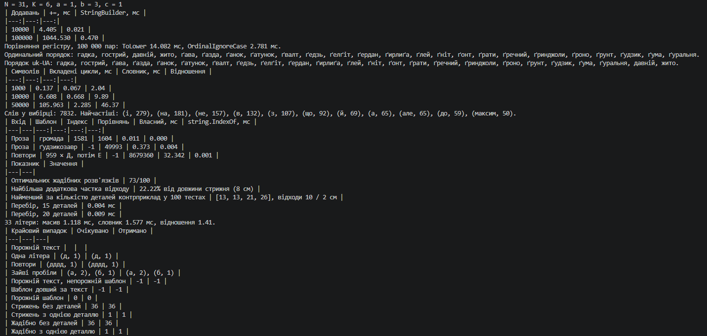

N = 31, K = 6, a = 1, b = 3, c = 1

# Лабораторна 10. Рядки та вибір алгоритму

Запуск із цієї папки (.NET 10 SDK): `dotnet run -c Release --file Program.cs`.

Текст для замірів вбудовано в `Program.cs`. Час наведено в мілісекундах, найменший із трьох запусків після прогріву.

## Результати

| Додавань | +=, мс | StringBuilder, мс |
|---:|---:|---:|
| 10000 | 3.923 | 0.019 |
| 100000 | 549.387 | 0.091 |

Порівняння регістру, 100 000 пар: ToLower 14.534 мс, OrdinalIgnoreCase 2.620 мс.

Ординальний порядок: гадка, гострий, давній, жито, ґава, ґазда, ґанок, ґатунок, ґвалт, ґедзь, ґелґіт, ґердан, ґирлиґа, ґлей, ґніт, ґонт, ґрати, ґречний, ґринджоли, ґроно, ґрунт, ґудзик, ґума, ґуральня.

Порядок uk-UA: гадка, гострий, ґава, ґазда, ґанок, ґатунок, ґвалт, ґедзь, ґелґіт, ґердан, ґирлиґа, ґлей, ґніт, ґонт, ґрати, ґречний, ґринджоли, ґроно, ґрунт, ґудзик, ґума, ґуральня, давній, жито.

| Символів | Вкладені цикли, мс | Словник, мс | Відношення |
|---:|---:|---:|---:|
| 1000 | 0.106 | 0.078 | 1.37 |
| 10000 | 3.346 | 0.584 | 5.73 |
| 50000 | 50.998 | 2.234 | 22.83 |

Слів у вибірці: 7832. Найчастіші: (і, 279), (на, 181), (не, 157), (в, 132), (з, 107), (що, 92), (й, 69), (а, 65), (але, 65), (до, 59), (максим, 50).

| Вхід | Шаблон | Індекс | Порівнянь | Власний, мс | string.IndexOf, мс |
|---|---|---:|---:|---:|---:|
| Проза | громада | 1581 | 1604 | 0.010 | 0.000 |
| Проза | ґудзикозавр | -1 | 49993 | 0.050 | 0.004 |
| Повтори | 959 × Д, потім Е | -1 | 8679360 | 4.735 | 0.001 |

| Показник | Значення |
|---|---|
| Оптимальних жадібних розв'язків | 73/100 |
| Найбільша додаткова частка відходу | 22.22% від довжини стрижня (8 см) |
| Найменший за кількістю деталей контрприклад у 100 тестах | [13, 13, 21, 26], відходи 10 / 2 см |
| Перебір, 15 деталей | 0.003 мс |
| Перебір, 20 деталей | 0.006 мс |

33 літери: масив 0.935 мс, словник 1.158 мс, відношення 1.24.

| Крайовий випадок | Очікувано | Отримано |
|---|---|---|
| Порожній текст |  |  |
| Одна літера | (д, 1) | (д, 1) |
| Повтори | (дддд, 1) | (дддд, 1) |
| Зайві пробіли | (а, 2), (б, 1) | (а, 2), (б, 1) |
| Порожній текст, непорожній шаблон | -1 | -1 |
| Шаблон довший за текст | -1 | -1 |
| Порожній шаблон | 0 | 0 |
| Стрижень без деталей | 36 | 36 |
| Стрижень з однією деталлю | 1 | 1 |
| Жадібно без деталей | 36 | 36 |
| Жадібно з однією деталлю | 1 | 1 |

## Пояснення замірів

1. `+=` створює новий рядок і копіює попередні символи на кожній ітерації. `StringBuilder` накопичує символи в буферах і створює рядок наприкінці.
2. У 100 000 порівнянь у нижньому регістрі виклики `ToLower` створюють проміжні рядки, коли регістр змінюється. `OrdinalIgnoreCase` порівнює одразу.
3. За `uk-UA` слова з «ґ» стоять між «г» і «д». Ординально вони опинилися після «ж», бо порівнюються коди символів.
4. На тексті з повторів майже кожна спроба доходить до останньої літери шаблону, тому 9 041 позиція дає 8 679 360 порівнянь. Для вбудованого пошуку вимірювався тільки час. Його ординальна реалізація може пропускати більші ділянки або перевіряти символи групами. Значення `0.000` у таблиці означає результат, округлений до 0,001 мс.
5. У задачі стрижня кожну заготовку можна вибрати щонайбільше один раз. Для контрприкладу жадібний варіант бере 26 см, а перебір знаходить 21 + 13 = 34 см. Відсоткова різниця подана від 36 см, щоб нульовий оптимальний відхід теж можна було порівняти.
6. Масив на 33 позиції тут швидший приблизно в 1,24 раза. Індексування через українську абетку потребує явного правила для цифр, латинки й символів поза нею. У вимірюванні обидва варіанти відкидають однакові символи, щоб рахувати те саме.

## Вибір алгоритму для найчастіших слів

1. Робочий обсяг — уривок із 50 000 символів із «Захара Беркута». Після виділення слів отримано 7 832 токени.
2. Потрібен один запит про 11 найчастіших слів, із однаковим правилом для нічиїх. Якщо кількість потрібних позицій змінюється, підраховані частоти можна використати повторно.
3. Вхідний файл під час запиту фіксований. Для іншого уривка частоти треба підрахувати знову.
4. За такого розміру головна різниця — час: приблизно 51,0 мс для перебору проти 2,23 мс зі словником. У методі з перебором 14 рядків тіла коду, у методі зі словником — 10, без підписів, зовнішніх дужок і спільних допоміжних методів.
5. Стандартна бібліотека дає `Dictionary`, `HashSet` і `Array.Sort`. Виділення слів, підрахунок та правило нічиєї задані в проєкті.
6. Для 50 000 символів обрано словник: результат збігається з перебором, а виміряний час менший у 22,83 раза.

Джерело прози — Іван Франко, [«Захар Беркут», Вікіджерела](https://uk.wikisource.org/wiki/Твори_(Франко,_1956–1962)/13/Захар_Беркут), уривок із початку повісті без розмітки.

