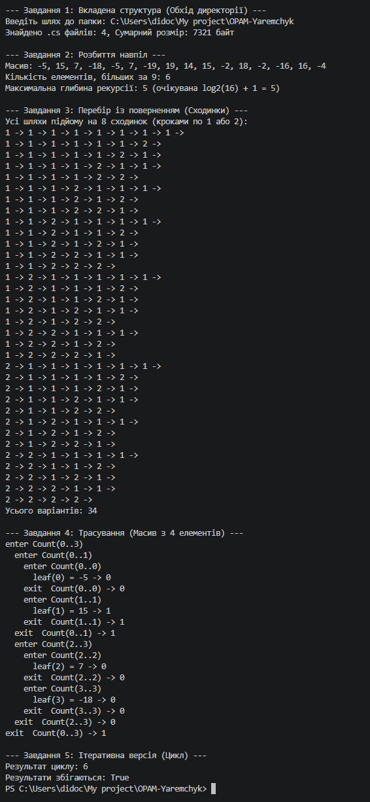

## Опис виконаних завдань

* **Завдання 1 (Вкладена структура):** Рекурсивний обхід ієрархії каталогів файлової системи. Функція приймає об'єкт директорії, підраховує кількість файлів із розширенням `.cs` та їхній сумарний розмір у байтах, а також рекурсивно викликає себе для всіх вкладених папок. Для системних та захищених папок реалізовано перехоплення винятку `UnauthorizedAccessException` із пропуском такої директорії.
* **Завдання 2 (Розбиття навпіл):** Рекурсивний обчислювальний алгоритм за схемою «поділ навпіл». Масив із 16 випадкових елементів (згенерованих через `new Random(N)`) рекурсивно ділиться на дві рівні частини до досягнення підмасиву з одного елемента, після чого результати лівої та правої частин додаються. Додатково вимірюється максимальна глибина рекурсії.
* **Завдання 3 (Перебір із поверненням):** Генерація всіх можливих варіантів підйому на $M$ сходинок кроками по 1 або 2 (де $M = K \bmod 8 + 5 = 8$). Алгоритм будує рішення за схемою backtracking: робить вибір (1 або 2 кроки), рухається вглиб рекурсії, а при поверненні переходить до наступного варіанта. Наприкінці виводиться загальна кількість знайдених способів.
* **Завдання 4 (Трасування):** Модифікація алгоритму із Завдання 2 додаванням параметра глибини (`depth`) для візуалізації роботи системного стека викликів на масиві з 4 елементів.
* **Завдання 5 (Ітеративна версія):** Реалізація алгоритму із Завдання 2 за допомогою звичайного циклу `for` без використання рекурсії та порівняння отриманих результатів.

---

## Базові випадки рекурсивних функцій

* **Завдання 1 (Обхід каталогів):** Базовий випадок є неявним. Якщо папка не містить усередині інших підпапок, цикл обходу вкладених каталогів не виконується жодного разу, і функція завершує роботу, повертаючи результат тільки для поточного каталогу.
* **Завдання 2 (Розбиття навпіл):** Базовим випадком є ситуація, коли ліва та права межі підмасиву збігаються (`lo == hi`), тобто підмасив складається з одного елемента. У цьому разі поділ зупиняється і повертається 1 (якщо елемент більший за $K \bmod 10$) або 0.
* **Завдання 3 (Перебір із поверненням):** Базовим випадком є досягнення нульової кількості залишкових сходинок (`remainingSteps == 0`), що означає успішне завершення одного з варіантів підйому.

---

## Трасування стека викликів (Завдання 4)

Вивід програми під час виконання рекурсивного обчислення на масиві з 4 елементів:

enter Count(0..3)
  enter Count(0..1)
    enter Count(0..0)
      leaf(0) = 5 -> 0
    exit  Count(0..0) -> 0
    enter Count(1..1)
      leaf(1) = 12 -> 1
    exit  Count(1..1) -> 1
  exit  Count(0..1) -> 1
  enter Count(2..3)
    enter Count(2..2)
      leaf(2) = -8 -> 0
    exit  Count(2..2) -> 0
    enter Count(3..3)
      leaf(3) = 15 -> 1
    exit  Count(3..3) -> 1
  exit  Count(2..3) -> 1
exit  Count(0..3) -> 2

**Пояснення порядку виходів:**
Рядки `exit` з'являються у зворотному порядку до `enter`, оскільки програма використовує системну структуру даних — стек викликів (керується принципом LIFO: Last In, First Out). Кожен новий рекурсивний виклик підключає новий кадр на вершину стека, і батьківська функція не може завершити своє виконання та вивести `exit`, поки всі викликані нею дочірні функції не завершаться і не повернуть своє значення.

---

## Порівняльний аналіз та відповіді на запитання (Завдання 5)

1. **Який запис зрозуміліший для цієї задачі — рекурсивний чи циклічний, і чому?**  
   Для Завдання 2 (підрахунок елементів за умовою в одновимірному масиві) значно зрозумілішим і доречнішим є циклічний запис. Пошук у масиві є стандартною лінійною операцією, яка природно описується одним циклом `for`. Рекурсивний поділ навпіл у цій задачі штучно ускладнює код, створює додаткові накладні витрати на виклики функцій та вимагає використання пам'яті в стеці без жодної алгоритмічної переваги.

2. **Чому так само просто переписати циклом Завдання 1 не вийде? Якої саме допоміжної структури даних для цього бракує?**  
   Переписати Завдання 1 звичайним циклом не вийде тому, що файлова система має вкладену древоподібну структуру з невизначеною наперед глибиною. Звичайний цикл може проходити лише по одному пласкому списку. Для ітеративного обходу файлового дерева циклом бракує явного використання допоміжної структури даних — **Стека (`Stack`)** або **Черги (`Queue`)**. Під час рекурсії роль цієї структури незапобіжно виконує системний стек викликів (зберігаючи стан і незавершені папки у локальних змінних кожного кадру); при відмові від рекурсії розробник змушений створювати та вести такий стек у пам'яті вручну.

---

## Перевірка крайових випадків

| Вхід | Завдання | Очікувано | Отримано |
| :--- | :---: | :--- | :--- |
| порожня папка | 1 | 0 файлів `.cs`, розмір 0 байт | 0 файлів `.cs`, розмір 0 байт |
| папка, до якої немає доступу | 1 | Пропуск папки без збою програми | Помилку перехоплено, папку пропущено |
| масив з одного елемента | 2 | Перевірка 1 елемента, глибина рекурсії = 1 | Корректне значення (0 або 1), глибина = 1 |
| усі елементи однакові | 2 | Коректна загальна кількість за умовою | Точна кількість відповідних елементів |
| варіантів не існує (наприклад, $M = 0$) | 3 | 0 варіантів, програма не падає | 0 варіантів, сума = 0 |

---

## Висновок

У ході виконання лабораторної роботи було практично опановано базові прийоми та форми рекурсивних алгоритмів у мові C#:
1. **Обхід вкладених структур:** Реалізовано рекурсивну навігацію ієрархією папок файлової системи з неявним базовим випадком та обробкою винятків доступу (`UnauthorizedAccessException`).
2. **Розбиття задачі навпіл (Divide and Conquer):** Застосовано алгоритм поділу масиву на дві половини до досягнення базового випадку ($lo == hi$). Практично підтверджено, що максимальна глибина рекурсії відповідає теоретичній оцінці $\log_2(N) + 1$.
3. **Перебір із поверненням (Backtracking):** Побудовано рекурсивну функцію для генерації всіх можливих варіантів розв'язку задачі з логікою «зробити крок — заглибитись — скасувати крок».

**Ключові висновки за результатами трасування та порівняння:**
* **Стек викликів (LIFO):** Трасування показує, що повернення з функцій (`exit`) виконуються у зворотному порядку до їхнього виклику (`enter`). Це обумовлено використанням системного стека викликів, де поточна функція чекає на завершення всіх своїх дочірніх рекурсивних викликів.
* **Рекурсія vs Цикл:** 
  * Для лінійних задач на масивах (Завдання 2) циклічний запис є значно простішим, читабельнішим та ефективнішим за пам'яттю, оскільки не створює накладних витрат на стек викликів.
  * Для ієрархічних та дерев'янистих структур (Завдання 1) рекурсія є природним і зручним інструментом. Переписати такий алгоритм циклом без рекурсії можливо лише за умови використання власної допоміжної структури даних (**Стека** або **Черги**) для явного збереження стану обходу.

