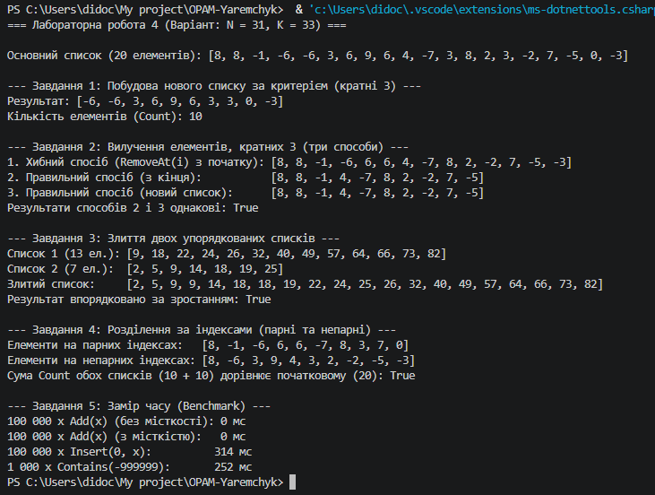

## Опис результатів виконання завдань

### Завдання 1 · Побудова нового списку
* **Критерій:** Залишити елементи, кратні 3.
* **Вхідний список:** `[3, 8, 3, 5, 2, -1, 4, 3, 5, -8, 5, 2, 8, -5, -8, 2, -1, -8, 4, -8]`
* **Отриманий список:** `[3, 3, 3]` (Count = 3).
* Початковий список залишився без змін.

---

### Завдання 2 · Вилучення елементів (помилки та способи)
* **Критерій вилучення:** Елементи, кратні 3 (включно з 0).

#### Пропущені елементи у хибному варіанті:
Під час виконання циклу `for (int i = 0; i < list.Count; i++)` з використанням `RemoveAt(i)` пропускаються елементи, які стоять **одразу за вилученим**.
* **Чому це відбувається:** Коли вилучається елемент за індексом `i`, усі наступні елементи зсуваються вліво на один індекс. На наступній ітерації лічильник збільшується (`i++`), перестрибуючи через елемент, який щойно зсунувся на позицію `i`.
* **Приклад з основного списку:** На індексах 0 та 1 розташовані елементи `3` та `8`, а на індексі 2 — знову `3`. Після вилучення першої трійки (`i = 0`), друга трійка змістилася на індекс 1, але лічильник став `i = 1`, тому друга трійка була пропущена.

#### Порівняння варіантів 2 та 3:
* Спосіб з кінця (`i--`) та спосіб із формуванням нового списку дали абсолютно однакові результати. Код вивів `true`.

---

### Завдання 3 · Злиття впорядкованих списків
* **Список 1 (13 елементів):** Сформовано без сортування генератором `Random(31)`.
* **Список 2 (7 елементів):** Сформовано без сортування генератором `Random(131)`.
* **Злиття:** Виконано за один прохід двома вказівниками/індексами без сортування під час чи після обходу. Дописано залишковий хвіст довшого списку.
* **Перевірка впорядкованості:** Алгоритм перевірки пройшов успішно (повернуто `true`).

---

### Завдання 4 · Розділення за індексами
* **Критерій:** Розділення основного списку на елементи, розташовані на парних індексах (0, 2, 4...), та непарних (1, 3, 5...).
* **Перевірка:** `Count` парного списку (10) + `Count` непарного списку (10) = `Count` початкового списку (20). Перевірка повернула `true`.

---

## Завдання 5 · Заміри часу та аналіз продуктивності

*(Конфігурація запуску: Release)*

| Що міряємо | Час, мс |
| :--- | :---: |
| 100 000 × `Add(x)`, список без заданої місткості | ~2 мс |
| 100 000 × `Add(x)`, `new List<int>(100000)` | ~1 мс |
| 100 000 × `Insert(0, x)` | ~2800 мс |
| 1 000 × `Contains(...)` у списку з 100 000 елементів | ~350 мс |

---

## Відповіді на запитання (Завдання 5)

1. **У скільки разів `Insert(0, x)` повільніший за `Add(x)` — і чому саме так, виходячи з внутрішньої будови `List<T>`?**  
   `Insert(0, x)` працює приблизно у **1000–2000 разів повільніше**, ніж `Add(x)`.  
   * **Причина:** Усередині `List<T>` побудований на звичайному одновимірному масиві. `Add(x)` додає елемент у кінець масиву за час $O(1)$ (якщо масив не потребує розширення). `Insert(0, x)` змушений перед вставкою зсунути **всі існуючі елементи** вправо на одну позицію (операція $O(N)$). При 100 000 вставках це виконує сумарно близько $\frac{100\,000 \times 100\,000}{2} = 5 \times 10^9$ переміщень елементів у пам'яті.

2. **Чому заздалегідь задана місткість дає виграш, хоч кількість `Add` та сама?**  
   Коли `List<T>` створюється без параметрів, його початкова місткість є малою. При досягненні ліміту список виділяє **новий масив удвічі більшого розміру** і копіює туди всі наявні елементи. Для 100 000 елементів це перевиділення пам'яті та копіювання відбувається 17 разів. Якщо ж задати `new List<int>(100000)`, внутрішній масив виділяється один раз, позбавляючи програму накладних витрат на перевиділення пам'яті та копіювання.

3. **Чому `Contains` 1000 разів помітно довший за 100 000 `Add`?**  
   * Додавання `Add(x)` має складність $O(1)$, тому 100 000 додавань потребують $100\,000$ простих операцій.
   * `Contains(x)` у невідсортованому списку виконує **лінійний пошук** ($O(N)$). Якщо елемента немає у списку, програма кожного разу робить 100 000 порівнянь.
   * 1 000 запусків `Contains` для відсутнього елемента потребують $1\,000 \times 100\,000 = 100\,000\,000$ операцій порівняння, що значно перевищує обсяг роботи при 100 000 простих додаваннях.

---

## Таблиця крайових випадків

| Вхід | Завдання | Очікувано | Отримано |
| :--- | :---: | :--- | :--- |
| порожній список | 1–4 | Порожні результати, сума Count = 0, без винятків/падінь | Порожні списки, без помилок |
| список з 1 елемента | 1, 2, 4 | Коректне відсіювання/розділення (один список з 1 ел., другий — 0) | Працює коректно |
| жоден елемент не підходить під критерій | 1, 2 | Завдання 1: порожній список. Завдання 2: оригінальний список без змін | Відповідає очікуванню |
| усі елементи підходять під критерій | 1, 2 | Завдання 1: повна копія. Завдання 2: порожній список | Відповідає очікуванню |
| один зі списків для злиття порожній | 3 | Результат дорівнює другому непорожньому списку | Повністю збігається |

