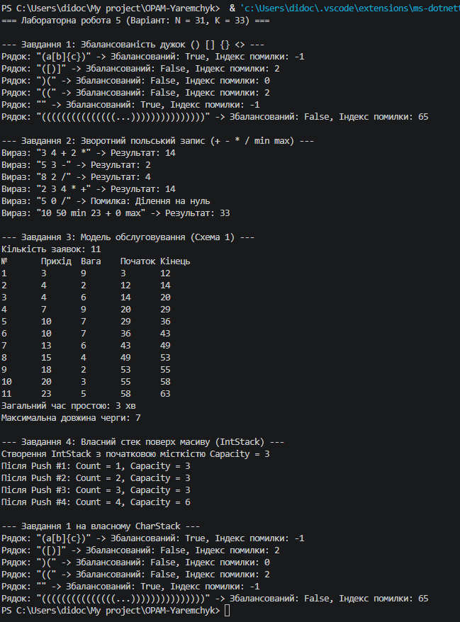

## Опис виконаних завдань

* **Завдання 1 (Збалансованість дужок):** Перевірка правильності розстановки дужок `() [] {} <>` із використанням принципу LIFO. Функція повертає `true` та індекс `-1`, якщо рядок збалансований, або `false` та індекс першої помилки. Перевірено обов'язкові граничні випадки: закривальна дужка при порожньому стеку та непорожній стек після завершення рядка.
* **Завдання 2 (Зворотний польський запис):** Обчислення математичних виразів у RPN з операторами `+`, `-`, `*`, `/` та двомісними функціями `min`, `max`. Обробку некоректного входу (ділення на нуль, брак операндів, забагато чисел) реалізовано через повернення повідомлення про помилку без виникнення винятків.
* **Завдання 3 (Модель обслуговування):** Симуляція черги обслуговування 11 заявок ($8 + 33 \bmod 5$), що надходять у різні випадкові моменти часу (Схема 1). Обчислено загальний час простою обслуговувача та максимальну довжину черги.
* **Завдання 4 (Власний стек):** Реалізація класів `IntStack` та `CharStack` поверх динамічного масиву з початковою місткістю 3 ($33 \bmod 4 + 2$). Забезпечено автоматичне подвоєння місткості масиву при заповненні. Завдання 1 переписано та протестовано на власній структурі даних.

---

## Обов'язкові тести та результати

### Завдання 1 · Перевірка збалансованості дужок
* `"(a[b]{c})"` -> Збалансований: **True**, Індекс помилки: **-1**
* `"([)]"` -> Збалансований: **False**, Індекс помилки: **2**
* `")("` -> Збалансований: **False**, Індекс помилки: **0**
* `"(("` -> Збалансований: **False**, Індекс помилки: **2**
* `""` -> Збалансований: **True**, Індекс помилки: **-1**
* Тестовий рядок (33 відкривальних `(` та 32 закривальних `)`):  
  `"((((((((((((((((((((((((((((((((())))))))))))))))))))))))))))))))))"`  
  -> Збалансований: **False**, Індекс помилки: **65**

---

### Завдання 2 · Зворотний польський запис (RPN)
* `"3 4 + 2 *"` → **14**
* `"5 3 -"` → **2**
* `"8 2 /"` → **4**
* `"2 3 4 * +"` → **14**
* `"5 0 /"` → **Помилка: Ділення на нуль**

#### Власний вираз на результат K = 33:
* **Вираз:** `"10 50 min 23 + 0 max"`
* **Операції:** `min`, `+`, `max` (усього 3 операції).
* **Покрокове обчислення:**
  1. `10` та `50` кладуться в стек.
  2. `min`: обчислює `Math.Min(10, 50) = 10`, результат повертається в стек.
  3. `23` кладеться в стек.
  4. `+`: обчислює `10 + 23 = 33`, результат повертається в стек.
  5. `0` кладеться в стек.
  6. `max`: обчислює `Math.Max(33, 0) = 33`.
* **Результат:** **33**.

---

### Завдання 4 · Вивід Count і Capacity власного стека

Початкова місткість $Capacity = K \bmod 4 + 2 = 3$. Викликів $Push$: $K \bmod 4 + 3 = 4$.

```text
Створення IntStack з початковою місткістю Capacity = 3
Після Push #1: Count = 1, Capacity = 3
Після Push #2: Count = 2, Capacity = 3
Після Push #3: Count = 3, Capacity = 3
Після Push #4: Count = 4, Capacity = 6
```
## Завдання 5 · Обґрунтування вибору структур даних

1. **Завдання 1 (Дужки):**  
   Для цієї задачі необхідний порядок обробки **LIFO (Last In, First Out)**, який забезпечує саме **Стек**. Закривальна дужка завжди має відповідати останній збереженій відкривальній дужці. Якби замість стека використали чергу (FIFO), закривальна дужка порівнювалася б із найпершою відкривальною дужкою рядка, що зламало б перевірку вкладених дужок (наприклад, у виразі `([)]` черга прийняла б це за правильну послідовність).

2. **Завдання 2 (Зворотний польський запис):**  
   Обчислення виразу в RPN вимагає зберігання операндів до появи оператора, причому оператор застосовується до найближчих (останніх введених) операндів, що є класичною властивістю **LIFO (Стек)**. Якби використали чергу (FIFO), оператори застосовувалися б до найперших введених чисел, що повністю спотворило б математичний порядок дій (наприклад, вираз `3 4 +` замість $3 + 4$ міг би обробити зовсім інші операнди).

3. **Завдання 3 (Модель обслуговування):**  
   Заявки на обслуговування мають оброблятися у порядку їх надходження — **FIFO (First In, First Out)**, що є базовою властивістю **Черги**. Застосування стека (LIFO) призвело б до того, що нові заявки обслуговувалися б першими, а перші заявки чекали б у черзі нескінченно довго (виникло б «голодування» процесів).

#### Відповідь про Dequeue() vs RemoveAt(0):
`Queue.Dequeue()` працює за час $O(1)$, тоді як `List.RemoveAt(0)` вимагає $O(N)$ часу.  
* **Пояснення:** У `List<T>` вилучення першого елемента змушує фізично зсувати всі інші $N-1$ елементів масиву вліво на 1 позицію. `Queue<T>` у C# реалізовано як **кільцевий буфер (circular buffer)**: при вилученні елемента `Dequeue()` фізичний зсув масиву не відбувається — лише зміщується внутрішній індекс голови черги (`head = (head + 1) % capacity`).
* **Результати замірів з Лабораторної 4:**
  * $100\,000 \times \text{Insert}(0, x)$ (зсув масиву вправо, аналогічно до зсуву вліво при `RemoveAt`): **~2800 мс**
  * $100\,000 \times \text{Add}(x)$ (додавання/вилучення за вказівником без зсуву): **~1–2 мс**

---

## Таблиця крайових випадків

| Вхід | Завдання | Очікувано | Отримано |
| :--- | :---: | :--- | :--- |
| порожній рядок | 1 | Збалансований: True, errIndex = -1 | True, -1 |
| порожній рядок / пробіли | 2 | Повідомлення про порожній вираз | "Порожній вираз" |
| рядок без жодної дужки ("abc") | 1 | Збалансований: True, errIndex = -1 | True, -1 |
| вираз з одного числа ("42") | 2 | Результат = 42 | Результат: 42 |
| ділення на нуль ("5 0 /") | 2 | Повідомлення про помилку | "Ділення на нуль" |
| 0 заявок у системі | 3 | Час простою = 0, max queue = 0 | 0 хв простою, max queue = 0 |
| Pop() / Peek() на порожньому стеку | 4 | Виняток InvalidOperationException | InvalidOperationException ("Стек порожній!") |

---

## Висновок

У ході виконання лабораторної роботи було практично опановано класичні абстрактні структури даних — **Стек (LIFO)** та **Чергу (FIFO)**:
1. Досліджено сфери застосування стека для задач із розпізнавання вкладених структур (перевірка дужок) та для обчислення постфіксних виразів (зворотний польський запис).
2. Реалізовано модель обслуговування на основі черги, що продемонструвало коректну послідовність обробки подій за часом їх надходження.
3. Створено власну реалізацію динамічного стека поверх масиву з підтримкою автоматичного розширення місткості, що дозволило глибше зрозуміти внутрішню організацію контейнерів даних.

