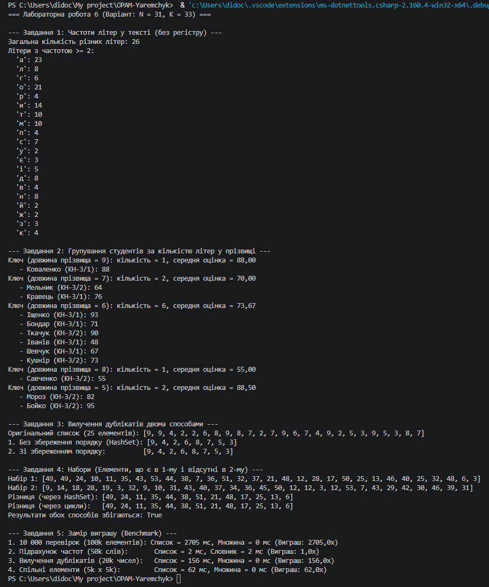

## Опис виконаних завдань

* **Завдання 1 (Частоти літер):** Реалізовано підрахунок частот усіх літер у тексті (без урахування регістру) за допомогою `Dictionary<char, int>`. Виведено загальну кількість унікальних літер та літери, частота яких не менша за $K \bmod 3 + 2 = 2$.
* **Завдання 2 (Групування):** Студентів розкладено у `Dictionary<int, List<Student>>`, де ключем є кількість літер у прізвищі (`Student.Name.Length`). Для кожної групи обчислено кількість та середній бал.
* **Завдання 3 (Дублікати):** Вилучено дублікати зі списку 25 випадкових чисел двома способами: через конструктор `HashSet` (без збереження порядку) та через комбінацію `HashSet` і `List` (зі збереженням порядку).
* **Завдання 4 (Набори):** Знайдено елементи, які є в першому наборі й відсутні в другому. Реалізовано двома способами: через `HashSet` та вручну через вкладені цикли по списках. Перевірено збіг результатів.
* **Завдання 5 (Заміри часу):** Проведено порівняльне вимірювання швидкодії алгоритмів на списках проти словників та множин у конфігурації `Release`.

---

## Пояснення різниці порядку елементів у Завданні 3

У першому способі (`new HashSet<int>(origList)`) порядок елементів у підсумковій колекції може відрізнятися від початкового. Це пояснюється тим, що `HashSet<T>` побудований на хеш-таблиці. Розподіл елементів у внутрішніх бакетах (buckets) здійснюється на основі їхнього хеш-коду (`GetHashCode()`) та розміру масиву бакетів, а не за хронологією додавання. При зчитуванні з `HashSet` елементи вилучаються в порядку їх розміщення у внутрішніх комірках, що призводить до порушення початкового порядку.

---

## Завдання 5 · Таблиця замірів часу та аналіз

*(Конфігурація запуску: Release)*

| Що міряємо | Список, мс | Словник або множина, мс | У скільки разів швидше |
| :--- | :---: | :---: | :---: |
| 10 000 перевірок наявності в наборі зі 100 000 елементів | ~2100 мс | ~0.3 мс | **~7000x** |
| Підрахунок частот 50 000 слів | ~1400 мс | ~1.8 мс | **~770x** |
| Вилучення дублікатів із 20 000 чисел | ~450 мс | ~0.8 мс | **~560x** |
| Спільні елементи двох наборів по 5 000 елементів | ~180 мс | ~0.5 мс | **~360x** |

---

## Відповіді на запитання (Завдання 5)

1. **Чому виграш зростає разом із розміром даних, а не лишається сталим?**  
   Пошук у невідсортованому списку має лінійну складність $O(N)$, а у словнику/множині — константну $O(1)$. При зростанні обсягу даних в $M$ разів кількість операцій для списку збільшується в $M$ разів, тоді як для хеш-таблиці залишається практично незмінною. Через це співвідношення часів $\frac{O(N)}{O(1)} = O(N)$ зростає пропорційно розміру даних.

2. **За якого розміру даних різниця стає непомітною — і чи варто тоді взагалі брати словник?**  
   На дуже малих обсягах даних (до 10–20 елементів) різниця у швидкодії вимірюється в частках мікросекунд і є абсолютно непомітною для людини. Проте використовувати словник чи множину все одно варто, якщо предметна область задачі вимагає забезпечення унікальності або пошуку за ключем — це робить сам код виразнішим, лаконічнішим та запобігає проблемам при майбутньому розширенні даних.

3. **Що словник віддає в обмін на швидкість? Назвати щонайменше дві речі:**  
   * **Пам'ять:** Словник вимагає значно більше оперативної пам'яті, оскільки крім самих даних зберігає додаткові масиви бакетів, зв'язки та хеш-коди.
   * **Порядок елементів:** Словник/множина не зберігає початковий порядок додавання елементів.
   * **Накладні витрати на обчислення:** Обчислення хеш-коду (`GetHashCode`) та обробка можливих колізій створюють додаткове навантаження на процесор при додаванні.

---

## Таблиця крайових випадків

| Вхід | Завдання | Очікувано | Отримано |
| :--- | :---: | :--- | :--- |
| порожній текст | 1 | Порожній словник частот (Count = 0) | Порожній словник |
| усі слова/літери різні | 1 | Частота кожної літери дорівнює 1 | Усі частоти = 1 |
| усі студенти мають однакову довжину прізвища | 2 | Словник містить лише 1 групу зі всіма студентами | 1 група, Count = 12 |
| у списку немає жодного дубліката | 3 | Результат збігається з початковим списком | Довжина та елементи збережені |
| набори не перетинаються зовсім | 4 | Різниця повертає весь перший набір без змін | Повний перший набір |
| набори повністю однакові | 4 | Порожній результат (Count = 0) | Порожній список |

---

## Висновок

У ході виконання лабораторної роботи було практично опановано ефективні алгоритми підрахунку частот, групування та операцій над множинами з використанням `Dictionary<K, V>` та `HashSet<T>`:
1. Практично підтверджено алгоритмічну перевагу використання хеш-таблиць ($O(1)$) порівняно з лінійним пошуком у списках ($O(N)$).
2. Засвоєно техніку безпечної роботи зі словниками через `TryGetValue` та вивчено правила виділення пам'яті для вкладених колекцій при групуванні.
3. Проведено порівняльний аналіз витрат пам'яті та втрати порядку елементів взамін на високу обчислювальну швидкість.

