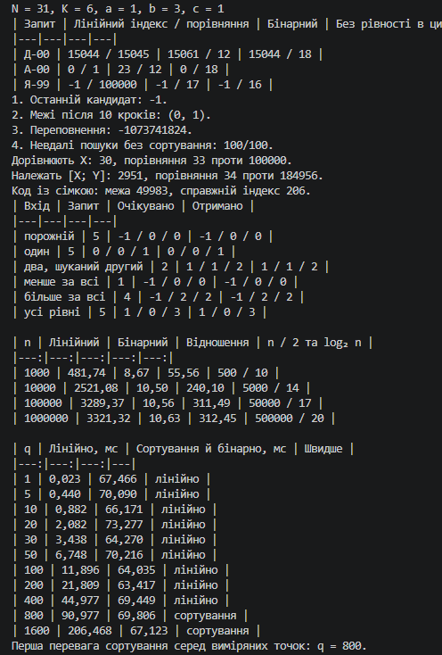

N = 31, K = 6, a = 1, b = 3, c = 1

# Лабораторна 8. Алгоритми пошуку

Запуск із цієї папки (.NET 10 SDK): `dotnet run -c Release --file Program.cs`.

У кожному замірі часу є прогрів і три запуски; у звіті наведено найменший час. Крайові випадки показують індекс, нижню та верхню межі.

## Результати

| Запит | Лінійний індекс / порівняння | Бінарний | Без рівності в циклі |
|---|---|---|---|
| Д-00 | 15044 / 15045 | 15061 / 12 | 15044 / 18 |
| А-00 | 0 / 1 | 23 / 12 | 0 / 18 |
| Я-99 | -1 / 100000 | -1 / 17 | -1 / 16 |

1. Останній кандидат: -1.
2. Межі після 10 кроків: (0, 1).
3. Переповнення: -1073741824.
4. Невдалі пошуки без сортування: 100/100.
Дорівнюють X: 30, порівняння 33 проти 100000.
Належать [X; Y]: 2951, порівняння 34 проти 184956.
Код із сімкою: межа 49983, справжній індекс 206.

| Вхід | Запит | Очікувано | Отримано |
|---|---|---|---|
| порожній | 5 | -1 / 0 / 0 | -1 / 0 / 0 |
| один | 5 | 0 / 0 / 1 | 0 / 0 / 1 |
| два, шуканий другий | 2 | 1 / 1 / 2 | 1 / 1 / 2 |
| менше за всі | 1 | -1 / 0 / 0 | -1 / 0 / 0 |
| більше за всі | 4 | -1 / 2 / 2 | -1 / 2 / 2 |
| усі рівні | 5 | 1 / 0 / 3 | 1 / 0 / 3 |

| n | Лінійний | Бінарний | Відношення | n / 2 та log₂ n |
|---:|---:|---:|---:|---:|
| 1000 | 481,74 | 8,67 | 55,56 | 500 / 10 |
| 10000 | 2521,08 | 10,50 | 240,10 | 5000 / 14 |
| 100000 | 3289,37 | 10,56 | 311,49 | 50000 / 17 |
| 1000000 | 3321,32 | 10,63 | 312,45 | 500000 / 20 |

| q | Лінійно, мс | Сортування й бінарно, мс | Швидше |
|---:|---:|---:|---|
| 1 | 0,022 | 91,503 | лінійно |
| 5 | 0,839 | 90,106 | лінійно |
| 10 | 0,972 | 85,046 | лінійно |
| 20 | 2,073 | 77,348 | лінійно |
| 30 | 3,032 | 73,867 | лінійно |
| 50 | 6,759 | 65,798 | лінійно |
| 100 | 11,091 | 64,304 | лінійно |
| 200 | 20,034 | 66,164 | лінійно |
| 400 | 49,464 | 79,017 | лінійно |
| 800 | 92,200 | 71,117 | сортування |
| 1600 | 188,302 | 69,470 | сортування |

Перша перевага сортування серед виміряних точок: q = 800.

## Пояснення

- Відсутній `Я-99` змушує лінійний пошук перевірити всі 100 000 позицій. Генератор навмисно залишає цей код поза набором. У відсортованому масиві з дублікатами класичний бінарний пошук може повернути будь-який із рівних елементів.
- У другій зламаній реалізації `lo = mid` залишає межі `(0, 1)` після 10 кроків на вході `[1, 2]` із ціллю 2. Виправлення — `lo = mid + 1`.
- `lo + hi` виходить за межі `int`, щойно сума перевищує 2 147 483 647. Для індексів це можливо починаючи з довжини 1 073 741 825, коли обидві межі дійдуть до 1 073 741 824. За довжини 100 000 найбільша сума дорівнює 199 998. Безпечна середина — `lo + (hi - lo) / 2`.
- Пошук межі ділить ділянку навпіл незалежно від кількості дублікатів. Предикат «у номері є 7» змінюється з істини на хибу й назад усередині відсортованого масиву. Це порушує умову пошуку межі, тому отриманий індекс 49983 відрізняється від правильного 206.
- Пошук без рівності в циклі знаходить першу можливу позицію, а потім окремо перевіряє кандидата. Для `Д-00` він зробив 18 порівнянь проти 12 у класичному варіанті, який зупинився на першому знайденому збігу. Для запиту вище за максимальний значення-кандидат відсутнє й останнє порівняння пропускається.

## Висновки

Сортування вперше виграло серед перевірених точок при 800 запитах, що більше за лекційну оцінку 34. Початкове культурне сортування рядків коштує десятки мілісекунд, а багато повторів дозволяють лінійному пошуку знайти першу копію за значно менше ніж `n/2` порівнянь.

Для запиту «чи є код?» зручно підтримувати `HashSet`, а для запиту про кількість копій — `Dictionary<string, int>`. Для підрахунку значень у довільному діапазоні відсортований масив дає дві межі за логарифмічний час, тоді як звичайний словник довелося б обходити.

Коли дані змінюються після кожного запиту, для точного пошуку підійде словник, який оновлюється разом із потоком. Для одного запиту до малого набору достатньо перебору. Повторне сортування після кожної зміни додає витрати, яких немає при підтримуванні словника.

