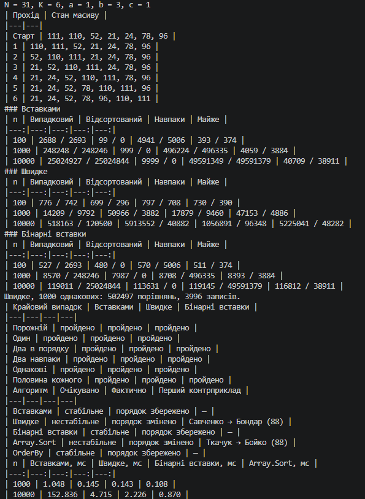

N = 31, K = 6, a = 1, b = 3, c = 1

# Лабораторна 9. Алгоритми сортування

Запуск із цієї папки (.NET 10 SDK): `dotnet run -c Release --file Program.cs`.

У таблицях операцій наведено «порівняння / записи». Для часу виконано прогрів і три заміри в Release, наведено мінімум. Межу однієї секунди можна перевірити окремо командою `dotnet run -c Release --file Program.cs -- --threshold-only`.

## Результати

| Прохід | Стан масиву |
|---|---|
| Старт | 111, 110, 52, 21, 24, 78, 96 |
| 1 | 110, 111, 52, 21, 24, 78, 96 |
| 2 | 52, 110, 111, 21, 24, 78, 96 |
| 3 | 21, 52, 110, 111, 24, 78, 96 |
| 4 | 21, 24, 52, 110, 111, 78, 96 |
| 5 | 21, 24, 52, 78, 110, 111, 96 |
| 6 | 21, 24, 52, 78, 96, 110, 111 |

### Вставками

| n | Випадковий | Відсортований | Навпаки | Майже |
|---:|---:|---:|---:|---:|
| 100 | 2688 / 2693 | 99 / 0 | 4941 / 5006 | 393 / 374 |
| 1000 | 248248 / 248246 | 999 / 0 | 496224 / 496335 | 4059 / 3884 |
| 10000 | 25024927 / 25024844 | 9999 / 0 | 49591349 / 49591379 | 40709 / 38911 |

### Швидке

| n | Випадковий | Відсортований | Навпаки | Майже |
|---:|---:|---:|---:|---:|
| 100 | 776 / 742 | 699 / 296 | 797 / 708 | 730 / 390 |
| 1000 | 14209 / 9792 | 50966 / 3882 | 17879 / 9460 | 47153 / 4886 |
| 10000 | 518163 / 120500 | 5913552 / 40882 | 1056891 / 96348 | 5225041 / 48282 |

### Бінарні вставки

| n | Випадковий | Відсортований | Навпаки | Майже |
|---:|---:|---:|---:|---:|
| 100 | 527 / 2693 | 480 / 0 | 570 / 5006 | 511 / 374 |
| 1000 | 8570 / 248246 | 7987 / 0 | 8708 / 496335 | 8393 / 3884 |
| 10000 | 119011 / 25024844 | 113631 / 0 | 119145 / 49591379 | 116812 / 38911 |

Швидке, 1000 однакових: 502497 порівнянь, 3996 записів.

| Крайовий випадок | Вставками | Швидке | Бінарні вставки |
|---|---|---|---|
| Порожній | пройдено | пройдено | пройдено |
| Один | пройдено | пройдено | пройдено |
| Два в порядку | пройдено | пройдено | пройдено |
| Два навпаки | пройдено | пройдено | пройдено |
| Однакові | пройдено | пройдено | пройдено |
| Половина кожного | пройдено | пройдено | пройдено |

| Алгоритм | Очікувано | Фактично | Перший контрприклад |
|---|---|---|---|
| Вставками | стабільне | порядок збережено | — |
| Швидке | нестабільне | порядок змінено | Савченко → Бондар (88) |
| Бінарні вставки | стабільне | порядок збережено | — |
| Array.Sort | нестабільне | порядок змінено | Ткачук → Бойко (88) |
| OrderBy | стабільне | порядок збережено | — |

| n | Вставками, мс | Швидке, мс | Бінарні вставки, мс | Array.Sort, мс |
|---:|---:|---:|---:|---:|
| 1000 | 0.631 | 0.121 | 0.101 | 0.059 |
| 10000 | 64.145 | 2.164 | 1.832 | 0.782 |
| 100000 | 6533.756 | 110.221 | 158.206 | 6.180 |
| 1000000 | — | 10927.257 | 28099.134 | 70.860 |

Межа 1 с: від 39000 до 40000 елементів за найшвидшим із трьох запусків.

## Висновки

- Для `n = 10 000` на випадковому вході звичайні вставки зробили 25 024 927 порівнянь, а швидке сортування — 518 163. Відношення приблизно 48,3 замість лекційних 376. Тут лише 121 можливе значення, тому багато елементів рівні опорному й залишаються з одного боку розбиття. На відсортованому вході довгі блоки повторів піднімають кількість порівнянь до 5 913 552. Це слабке місце обраного двостороннього поділу на «менше» та «решту».
- На випадковому вході з 10 000 елементів бінарні вставки скоротили кількість порівнянь з 25 024 927 до 119 011, а обидва алгоритми зробили 25 024 844 записи. Квадратична кількість зсувів зберігається. У цьому запуску час бінарних вставок зменшився також завдяки `Array.Copy`, який пересуває цілий блок за один виклик. Для впорядкованого масиву прості вставки мають 9 999 порівнянь проти 113 631 у бінарних, обидва без записів.
- `Array.Sort` змінює стратегію залежно від розміру підмасиву та глибини розбиття. Також він не веде наші лічильники порівнянь і записів. Обидві відмінності коштують часу у власній реалізації.
- Для 100 000 записів із ключами 0–300 потрібне стабільне сортування підрахунком. Масив із 301 лічильника дає позиції через префіксні суми. Обхід записів у початковому порядку й запис у наступну вільну позицію свого ключа зберігають порядок рівних.
- Під час тесту стабільності набір із №6 доповнено тими самими прізвищами з однаковим тестовим балом 88, щоб створити групу рівних ключів. Значення `-1` у лічильнику означає вихід за межі `int`; для великих масивів таблиця містить лише час.

